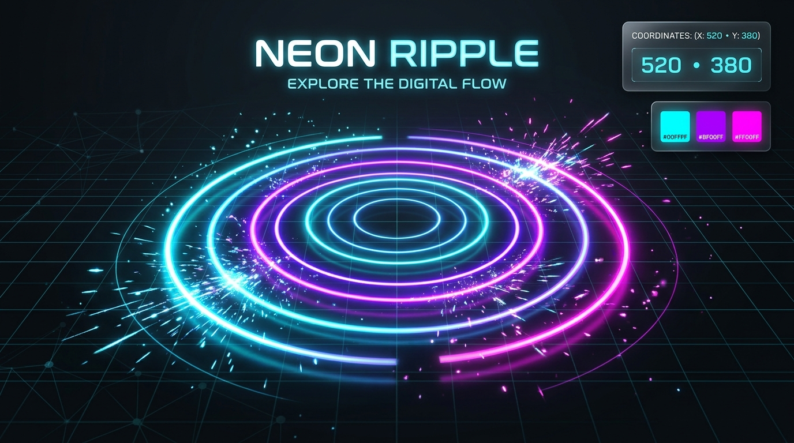

# Neon Ripple 🌌✨

An interactive, sensory click and tap experience featuring dynamic multi-touch ripples, particle bursts, synthesized audio chimes, and persistent canvas stamps.

[](https://mahesh-yennam.github.io/Neon-Ripple/)


> 🌐 **Live Website**: [https://mahesh-yennam.github.io/Neon-Ripple/](https://mahesh-yennam.github.io/Neon-Ripple/)



---

## 🚀 Features

- **Midnight Cosmic Dark Theme**: Deep dark backdrop with subtle ambient radial illumination reacting to touch coordinates and a futuristic micro-grid.
- **Glassmorphic HUD**: Real-time display showing cursor/tap coordinates `(X, Y)`, viewport percentages, live golden-ratio color preview swatch, and ripple counter.
- **3 Interactive Visual Modes**:
  - 🔘 **Neon Ripple**: Multi-tiered expanding shockwave rings with pulsating luminous core.
  - ✨ **Sparkle Burst**: Explosive bursts of 14 radiant micro-particles radiating outwards along randomized trajectories.
  - 🎨 **Persistent Stamp**: Interactive art mode to stamp and draw on the canvas, with smooth auto-eviction to maintain 60+ FPS.
- **Web Audio Chime Synthesizer**: Native Web Audio API procedural synthesis mapping touch vertical position `(Y)` to harmonic notes in a Pentatonic scale.
- **Mobile Responsive & Multi-Touch**:
  - Instant response with `pointerdown` (no 300ms tap latency).
  - Multi-touch support for tapping with multiple fingers simultaneously.
  - `touch-action: none` to prevent unintended pull-to-refresh and zooming.
- **Hardware Accelerated**: GPU-accelerated transforms (`translate3d`), with automatic DOM node lifecycle cleanup via `animationend`.

---

## ⌨️ Keyboard Shortcuts

| Key | Action |
| :---: | :--- |
| <kbd>1</kbd> | Switch to **Ripple** mode |
| <kbd>2</kbd> | Switch to **Sparks** mode |
| <kbd>3</kbd> | Switch to **Stamp** mode |
| <kbd>C</kbd> | Clear screen and stamps |
| <kbd>M</kbd> | Toggle audio chime (Mute / Unmute) |
| <kbd>Space</kbd> | Trigger a random ripple |

---

## 📦 Project Structure

```text
Neon-Ripple/
├── index.html        # Semantic HTML5 stage, HUD, and glass dock
├── style.css         # Dark aesthetic design system & GPU keyframe animations
├── script.js         # Interaction engine, multi-touch, and Web Audio API
├── favicon.svg       # Glowing neon ripple vector favicon
├── preview.png       # 16:9 HD visual showcase banner
├── site.webmanifest  # PWA web manifest
├── sitemap.xml       # Search engine sitemap
├── robots.txt        # Search engine crawler directives
├── .gitignore        # Git ignore rules
└── README.md         # Project documentation
```

